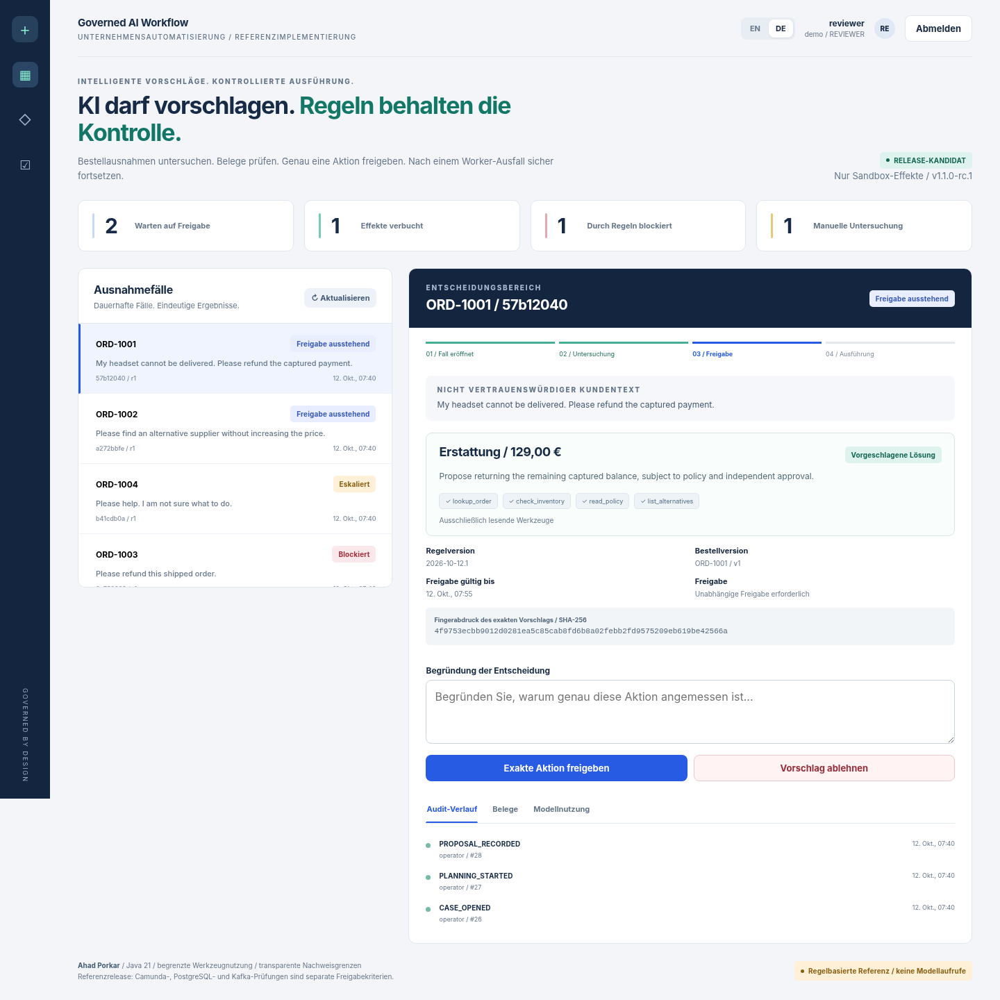

<div align="center">

# Governed AI Workflow Platform
### KI schlägt vor. Regeln autorisieren. Worker führen aus.

**Java 21 - begrenzte Tool-Nutzung - unabhängige Freigabe - dauerhafte Belege - DE / EN**

**1.1.0-rc.1 | Portfolio-Sandbox | Ahad Porkar**

[Deutscher Leitfaden](docs/de/overview.md) | [English documentation](docs/en/overview.md) | [Verifikation](docs/de/testing.md) | [Release-Dossier](docs/de/release.md)

</div>



## Ein überzeugender Assistent ist kein autorisierter Sachbearbeiter

Eine nicht lieferbare Bestellung schafft Unsicherheit. Der Planer darf sie untersuchen; die Berechtigung zum Handeln bleibt bei deterministischen Regeln, einer unabhängigen Person und einer transaktional durchgesetzten Ausführungsgrenze.

Die zentrale Demonstration: **Worker nach dem Commit einer Sandbox-Erstattung abbrechen, Server neu starten, wiederholen und denselben Beleg ohne zweiten Effekt erhalten.**

## Lokal starten

```bash
python scripts/run_demo.py
```

Java-21-JDK und Python ab 3.10 erforderlich. `http://127.0.0.1:8095` öffnen, Operator-/Reviewer-Tokens aus `.local/access.json` verwenden und nach der Freigabe `python scripts/worker.py --once` starten. Die Baseline benötigt weder Modellschlüssel noch Maven oder Docker. `.local` niemals veröffentlichen.

```bash
python scripts/test.py --repository
python scripts/evaluate.py --no-build
```

## Nachweise und Grenzen

| Implementiert und geprüft | Offene Grenze |
|---|---|
| 106 Java- sowie 29 HTTP-/Prozesstests. | Kein Maven-/Docker-Stacklauf in dieser Umgebung. |
| Neun Chromium-DOM-/Darstellungsprüfungen im offengelegten Harness. | Native Navigation, CSP und Browsernetzwerk noch offen. |
| Ollama-HTTP-/Tool-Adapter mit Protokollfixtures. | Kein echtes Modell evaluiert. |
| 48 gelabelte Fälle: 33 exakte Vorschläge, 40 zulässige Ergebnisse. | Keine Behauptung hoher semantischer Modellqualität. |
| Dauerhafte Sandbox-Effekte und echter Prozessabbruch. | Keine echte Zahlung, ERP-Änderung oder Lagerreservierung. |
| Additives Spring-/PostgreSQL-/Kafka-/Camunda-Overlay. | Kein zusammengeführtes, vollständig abgenommenes Host-Repository. |

Das hochgeladene Projekt war **RechnungFlow**, nicht das gewünschte BPMN-Repository. Es blieb unverändert. [Herkunft](PROVENANCE.json) und [Integrationsanleitung](docs/de/integration.md) erklären die Abgrenzung. Bestehende Host-APIs und Prozesse werden nicht stillschweigend ersetzt.

## Vertiefung

[Architektur](docs/de/architecture.md), [Sicherheit](docs/de/security.md), [API](docs/de/api.md), [Betrieb](docs/de/operations.md), [Evaluation](docs/de/evaluation.md), [Entscheidungen](docs/de/decisions.md) und [Vorführskript](docs/de/demo.md) unterstützen die technische Prüfung. Zweisprachige PDFs und LinkedIn-Entwürfe liegen unter `publishing/`.

Anwendungscode unter MIT; Laufzeit- und Modelllizenzen sind separat. Siehe [Quellen](docs/de/sources.md). Dies ist eine Portfolio-Sandbox als Release Candidate, keine Produktionszertifizierung.
