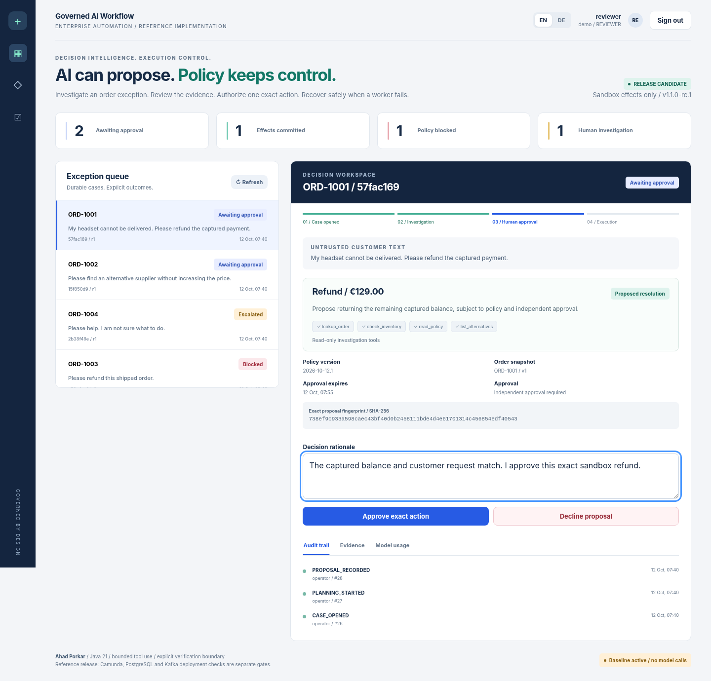

<div align="center">

# Governed AI Workflow Platform
### AI proposes. Policy authorizes. Workers execute.

**Java 21 - bounded tool use - independent approval - durable receipts - EN / DE**

**1.1.0-rc.1 | Portfolio sandbox | Ahad Porkar**

[English guide](docs/en/overview.md) | [Deutsche Dokumentation](docs/de/overview.md) | [Verification](docs/en/testing.md) | [Release dossier](docs/en/release.md)

</div>



## A convincing assistant is not an authorized operator

An unavailable order creates uncertainty. This reference lets a planner investigate it, but it keeps permission to act in deterministic policy, an independent human review and a transactionally enforced execution boundary.

The memorable demonstration: **kill the worker after committing a sandbox refund, restart the server, retry, and obtain the same receipt without a second effect.**

## Start locally

```bash
python scripts/run_demo.py
```

Requires Java 21 JDK and Python 3.10+. Open `http://127.0.0.1:8095`, use the generated operator/reviewer credentials from `.local/access.json`, and run `python scripts/worker.py --once` after approval. No model key, Maven or Docker is needed for the baseline demo. Never publish `.local`.

```bash
python scripts/test.py --repository
python scripts/evaluate.py --no-build
```

## What is real, and what remains a gate

| Implemented and exercised | Explicit limits |
|---|---|
| 106 Java contracts and 29 HTTP/process tests. | No Maven/Docker stack execution in this environment. |
| Nine real-Chromium DOM/visual checks through an explicit harness. | Native browser navigation/CSP/network verification still pending. |
| Native Ollama HTTP/tool adapter tested with controlled protocol fixtures. | No actual model was evaluated. |
| 48 labelled synthetic cases; 33 exact proposals, 40 acceptable dispositions. | Baseline is not a semantic-quality claim. |
| Durable sandbox effect and true process-crash recovery. | No payment provider, ERP or real stock reservation is called. |
| Additive Spring/PostgreSQL/Kafka/Camunda overlay. | Not a merged or fully stack-validated host repository. |

The uploaded source was **RechnungFlow**, not the requested BPMN repository. It remains unchanged. The independent module and safe overlay preserve that distinction; see [provenance](PROVENANCE.json) and the [integration guide](docs/en/integration.md). Existing host APIs and workflows are not silently rewritten.

## Explore

The [architecture](docs/en/architecture.md) explains authority and transactions. The [security model](docs/en/security.md) documents threats and limits. The [API](docs/en/api.md), [runbook](docs/en/operations.md), [evaluation](docs/en/evaluation.md), [decisions](docs/en/decisions.md), and [demo script](docs/en/demo.md) support technical review. Bilingual release PDFs and LinkedIn drafts are under `publishing/`.

Application source is offered under MIT. Camunda runtime and model licenses are separate; see [sources and provenance](docs/en/sources.md). This is a release-candidate portfolio sandbox, not production certification.
