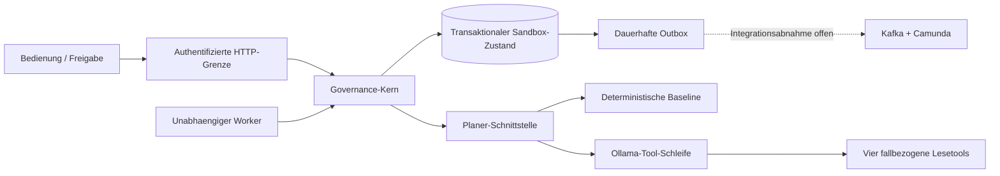
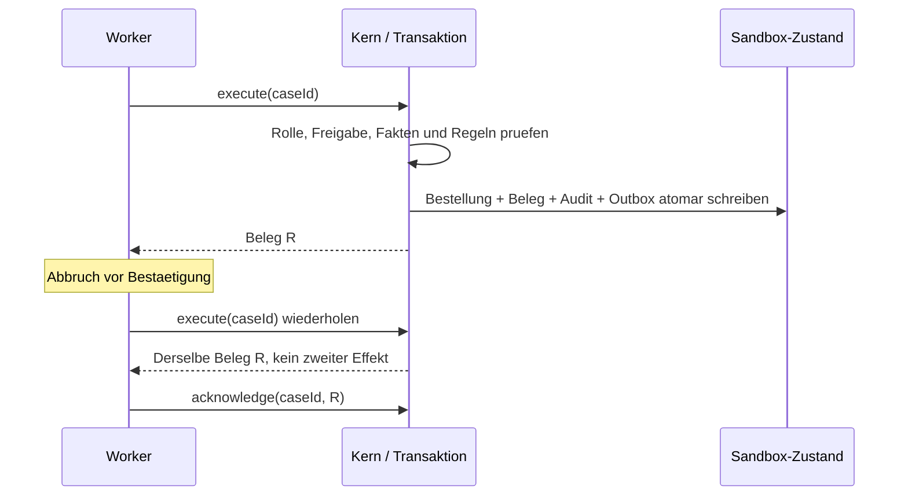

# Architektur und Autoritätsgrenzen

## Zwei Betriebswege, ein Anwendungskern

Der hier geprüfte lokale Weg nutzt den Java-HTTP-Server, einen atomaren Dateispeicher mit exklusivem Schreibprozess und einen separaten Java-Worker. Die Integrationsvariante ersetzt Transport und Speicherung durch Spring MVC und PostgreSQL und verbindet Kafka/Camunda. Beide verwenden denselben Anwendungskern. Die Adapter wurden hier nicht gegen ihre externen Abhängigkeiten kompiliert oder im echten Stack ausgeführt.

## Zustandsmodell

`CREATED` wird zu `PLANNING`. Ein zulässiger, ausführbarer Vorschlag wird `PENDING_APPROVAL`; Regelverletzungen werden `BLOCKED`, Unklarheit oder Modellfehler `ESCALATED`. Ein während der Planung geänderter Auftrag führt zu `INVALIDATED`.

Aus `PENDING_APPROVAL` entstehen `APPROVED`, `DECLINED` oder `EXPIRED`. Vor der Ausführung kann eine Freigabe wegen geänderter Fakten erneut ungültig werden. Ein erfolgreicher Commit erzeugt `EXECUTED`. Wiederholte Ausführung liefert denselben Beleg.

Der eigenständige Kern kann ungültige Fälle mit neuer Revision planen. Die mitgelieferte BPMN bildet **einen Freigabezyklus** ab. Nach einem beendeten ungültigen oder abgelaufenen Prozess ist ein neuer Fall für einen neuen Prozesszyklus zu erstellen. Ein HTTP-Aufruf zur Neuplanung startet nicht automatisch eine bereits beendete BPMN-Instanz neu.

## Ein Vorschlag ist keine Berechtigung

`OllamaPlanner` erhält nur `lookup_order`, `check_inventory`, `read_policy` und `list_alternatives`. Alle Tool-Argumente müssen leer sein. Mandant und Falldaten werden vom Server festgelegt. Das Modell kann weder fremde Bestellungen noch beliebige URLs, Abfragen oder Identitäten auswählen.

Die Ausgabe muss exakt dem Schema mit fünf Vorschlagsfeldern entsprechen. Der Kern kontrolliert gelesene Nachweise und deterministische Regeln. Ein gelesener Regeltext beweist allerdings kein semantisches Verständnis; die Person prüft weiterhin Absicht und genaue Wirkung.

Der Vorschlags-Hash bindet Mandant, Fall, Bestellung, Bestellversion, Regelversion, Vorschlagsrevision, Hash der Originalanfrage, vollständigen Vorschlag und Ablaufzeit. Die prüfende Person sendet Hash, Entscheidung und Begründung. Identität und Rollen stammen aus der Authentifizierung. Selbstfreigabe ist verboten.

Vor dem Commit kontrolliert der Kern erneut gespeicherte Freigabe, Hash, aktuelle Versionen, Ablaufzeit und Aktionsregeln. Eine Prozessvariable wie `approved=true` ersetzt niemals die gespeicherte Berechtigung.

## Commit und Bestätigung

`MemoryStore` isoliert Änderungen mit Copy-on-write. `FileStateStore` ergänzt Prozesssperre, fsync und atomaren Austausch. `JdbcStateStore` sperrt bewusst ein einzelnes Aggregat mit `SELECT ... FOR UPDATE`. Das vereinfacht den Korrektheitsnachweis, begrenzt aber den Durchsatz.

Die Hash-Kette des Audits ist eine lokale Konsistenzprüfung. Wer den gesamten vertrauenswürdigen Datenbestand umschreiben kann, kann auch eine neue Kette erzeugen. Externe Verankerung und revisionssichere Speicherung sind nicht implementiert.

## Nachrichten und externe Effekte

Der Zustand und seine Outbox werden gemeinsam gespeichert. Der Relay sendet mit stabiler Ereignis-ID an Kafka, bei passenden Ereignissen an Camunda und bestätigt erst danach die Outbox. Fehler dazwischen erlauben Wiederholungen. Kafka-Verbraucher müssen Ereignis-IDs deduplizieren; Camunda-Deduplizierung ist zeitlich begrenzt. Daraus folgt keine globale Exactly-once-Semantik.

Ein echter Zahlungsdienst benötigt einen eigenen Idempotenzschlüssel, dauerhaften Auftragszustand und Abgleich unklarer Ergebnisse. Ein entfernter API-Aufruf innerhalb der lokalen Transaktion macht die Gesamtheit nicht atomar.

---
[Überblick](overview.md) | [Schnellstart](quickstart.md) | [Architektur](architecture.md) | [Integration](integration.md) | [API](api.md) | [Sicherheit](security.md) | [Betrieb](operations.md) | [Tests](testing.md) | [Evaluation](evaluation.md) | [Release](release.md) | [Demo](demo.md) | [Entscheidungen](decisions.md) | [Quellen](sources.md)
