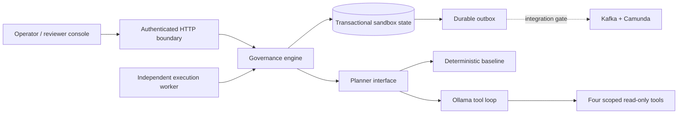
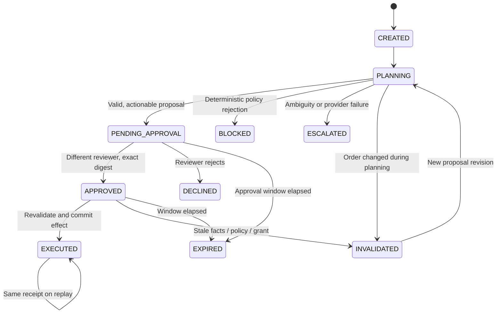
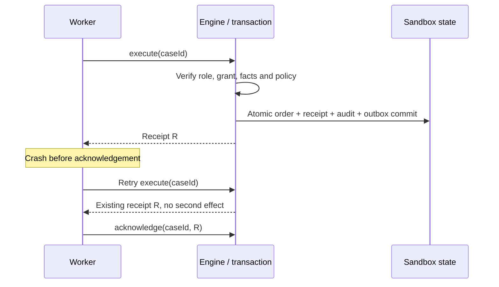

# Architecture and authority boundaries

## Two deployment paths, one application core

The verified local path uses Java's HTTP server, a single-writer atomic file store and a separate Java worker process. The integration path replaces transport/storage with Spring MVC and PostgreSQL, and delivers work through Kafka/Camunda. Both call the same engine. The integration adapters were not compiled against their external dependencies or executed in a real stack in this environment.

## State and transitions

The independent core supports re-planning an invalidated case. The supplied BPMN models a **single review lifecycle**; after a terminated invalidated/expired instance, create a new case for a new workflow lifecycle. Do not assume the reference adapter automatically restarts a terminated process when an old case is re-planned through HTTP.

## A proposal is not a capability

`OllamaPlanner` only receives `lookup_order`, `check_inventory`, `read_policy`, and `list_alternatives`. All tool arguments must be empty. The server supplies the tenant and case snapshot; the model cannot select an arbitrary order, destination URL, query, or identity.

Model output must parse as exactly the five allowed proposal fields. The engine verifies both evidence acquisition and deterministic policy. Reading the policy does not mean understanding it: the human still checks intent and the exact effect.

The proposal digest includes tenant, case ID, order ID, order version, policy version, proposal revision, original-request hash, exact proposal contents and expiry. A reviewer submits that digest, a Boolean decision and a reason. The server derives identity and roles from authenticated credentials. Self-approval is rejected.

The engine rechecks the persisted approval, digest, current order version, current policy version, expiry and action policy at execution. A process variable such as `approved=true` cannot replace a valid persisted grant.

## Commit versus acknowledgement

`MemoryStore` uses copy-on-write rollback. `FileStateStore` adds a process lock, file fsync, atomic replacement and directory fsync where supported. `JdbcStateStore` is a deliberately conservative single-row aggregate locked with `SELECT ... FOR UPDATE`. This is a correctness reference, not a high-throughput database design.

The hash-linked audit is a local consistency check. A privileged actor who rewrites the entire chain can forge it; external anchoring and access controls are not implemented.

## Integration semantics

The outbox is committed with state. Its relay sends a stable event ID to Kafka, sends applicable messages to Camunda, then acknowledges the outbox record. A crash between those steps can redeliver. Kafka consumers must deduplicate event IDs. Camunda message-ID deduplication is bounded by its TTL; neither mechanism creates a global exactly-once guarantee.

A real payment effect must move behind a provider idempotency key, durable command state and reconciliation of ambiguous outcomes. Never call a remote payment endpoint inside the sandbox transaction and then label the result atomic.

---
[Overview](overview.md) | [Quickstart](quickstart.md) | [Architecture](architecture.md) | [Integration](integration.md) | [API](api.md) | [Security](security.md) | [Operations](operations.md) | [Testing](testing.md) | [Evaluation](evaluation.md) | [Release](release.md) | [Demo](demo.md) | [Decisions](decisions.md) | [Sources](sources.md)
